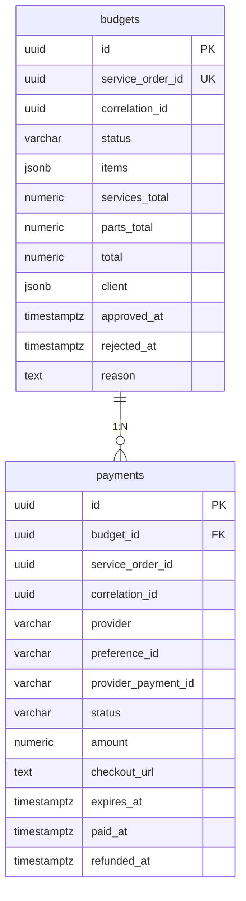

# billing-service

Microsserviço de orçamento e pagamento (PostgreSQL — database **`billing`**), integrado ao Mercado Pago e à saga coreografada via SNS/SQS.



| Tabela | Papel |
|---|---|
| `budgets` | Orçamento gerado a partir de `order.budget.requested` (1 por OS) |
| `payments` | Cobrança Mercado Pago ligada ao orçamento |

Auth: JWT emitido pelo **identity-service** (mesmo `JWT_SECRET`). Este MS só valida assinatura e papéis.

## Saga (coreografia)

Consome SQS `billing-events` (assinatura SNS `oficina-domain-events`) e publica de volta no SNS:

| Consome | Produz |
|---|---|
| `order.budget.requested` | `billing.budget.generated` / `billing.budget.failed` |
| `order.budget.approved` / `rejected` | (atualiza budget) |
| `stock.reserved` | `billing.payment.created` / `billing.payment.failed` |
| webhook / `POST /payments/:id/sync` | `billing.payment.confirmed` / `failed` |
| `order.cancelled` | `billing.payment.refunded` (+ cancela budget) |

`correlationId` = `serviceOrderId` em todos os eventos e nas tabelas. REST síncrono para o stock usa header `X-Correlation-Id`.

## Rodando local

```bash
cp .env.example .env
docker compose up -d postgres        # Postgres em localhost:5435
yarn migrate:up
yarn start:dev                       # API em http://localhost:3000 (compose: 3004)
```

Sem `MP_ACCESS_TOKEN`, o gateway usa stub (lab). Sem `SNS_TOPIC_ARN` / `SQS_QUEUE_URL`, publisher e consumer ficam noop/desligados.

Swagger: `/api`. Health: `/health/live`, `/health/ready`.

Testes: `yarn test` e `yarn test:integration:docker`.

## CI/CD (AWS)

Deploy em **EKS** (sem Kind). Banco no **RDS** (`infra-database`, database `billing`).

| Workflow | Quando | O que faz |
|---|---|---|
| `CI — billing-service` | push/PR | unit + integração (Postgres) + build |
| `Publish ECR — billing-service` | push `main` | push ECR + dispara `deploy-prod` no `infra-kubernetes` |

No EKS: Deployment `billing`, Job `billing-migration`, Service ClusterIP, Ingress ALB (`/billing`), HPA. Secret `billing-secret` vem do Terraform (`BILLING_DATABASE_URL`).

Detalhes: [`infra/README.md`](infra/README.md).

## Observabilidade

Filtro: `service = 'billing-service'` (componente `billing`). Eventos de saga carregam `correlationId`.
