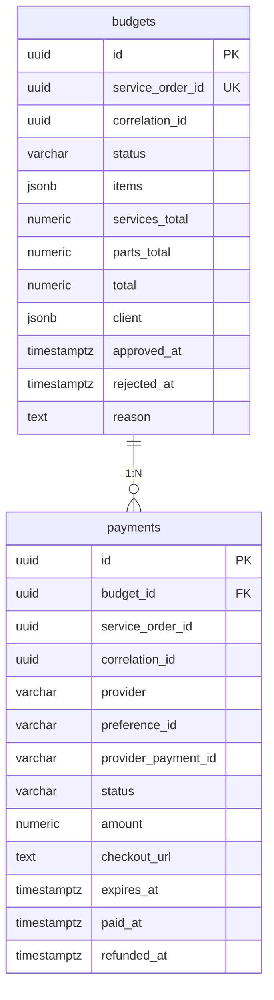

# billing-service

Microsserviço de orçamento e pagamento (PostgreSQL — database **`billing`**), integrado ao Mercado Pago e à saga coreografada via SNS/SQS.



| Tabela | Papel |
|---|---|
| `budgets` | Orçamento gerado a partir de `order.budget.requested` (1 por OS) |
| `payments` | Cobrança Mercado Pago ligada ao orçamento |

Auth: JWT emitido pelo **identity-service** (mesmo `JWT_SECRET`). Este MS só valida assinatura e papéis.

## Saga (coreografia)

Consome SQS `billing-events` (assinatura SNS `oficina-domain-events`) e publica de volta no SNS:

| Consome | Produz |
|---|---|
| `order.budget.requested` | `billing.budget.generated` / `billing.budget.failed` |
| `order.budget.approved` / `rejected` | (atualiza budget) |
| `stock.reserved` | `billing.payment.created` / `billing.payment.failed` |
| webhook / `POST /payments/:id/sync` | `billing.payment.confirmed` / `failed` |
| `order.cancelled` | `billing.payment.refunded` (+ cancela budget) |

`correlationId` = `serviceOrderId` em todos os eventos e nas tabelas. REST síncrono para o stock usa header `X-Correlation-Id`.

## Rodando local

```bash
docker network create oficina-net 2>/dev/null || true
cp .env.example .env
docker compose up -d          # billing :3004, postgres :5435, billing-localstack :4566
```

Sem `MP_ACCESS_TOKEN`, o gateway usa stub (lab). Lab completo (4 MS): [`../README.md`](../README.md).

### Filas AWS no local (LocalStack deste domínio)

O compose sobe `billing-localstack` (host **4566**) com init `scripts/localstack-ready.sh`:
- topic SNS `oficina-domain-events` (**AllowPublishers** + **AllowQueueSubscriptions**)
- fila `billing-events` (**AllowSnsDelivery** + **AllowConsumers**)
- subscription com **FilterPolicy** nos tipos que o billing consome

O app publica nos 3 LocalStacks (`SNS_FANOUT_ENDPOINTS`). Sem `SNS_TOPIC_ARN`, publisher noop; sem `SQS_QUEUE_URL`, consumer não sobe.

No host (API fora do compose):
```bash
yarn localstack:up && yarn localstack:init
set -a; source .env.localstack; set +a
yarn messaging:smoke
yarn start:dev
```

Swagger: `/api`. Health: `/health/live`, `/health/ready`.

Testes: `yarn test`, `yarn test:bdd` (fluxo saga) e `yarn test:integration:docker`.

## CI/CD (AWS)

Deploy em **EKS** (sem Kind). Banco no **RDS** (`infra-database`, database `billing`).

| Workflow | Quando | O que faz |
|---|---|---|
| `CI — billing-service` | push/PR | unit + integração (Postgres) + build |
| `Publish ECR — billing-service` | push `main` | push ECR + dispara `deploy-prod` no `infra-kubernetes` |

No EKS: Deployment `billing`, Job `billing-migration`, Service ClusterIP, Ingress ALB (`/billing`), HPA. Secret `billing-secret` vem do Terraform (`BILLING_DATABASE_URL`).

Detalhes: [`infra/README.md`](infra/README.md).

## Observabilidade

Filtro: `service = 'billing-service'` (componente `billing`). Eventos de saga carregam `correlationId`.

## Sonar


